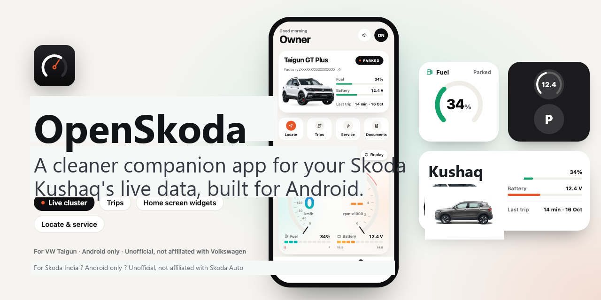
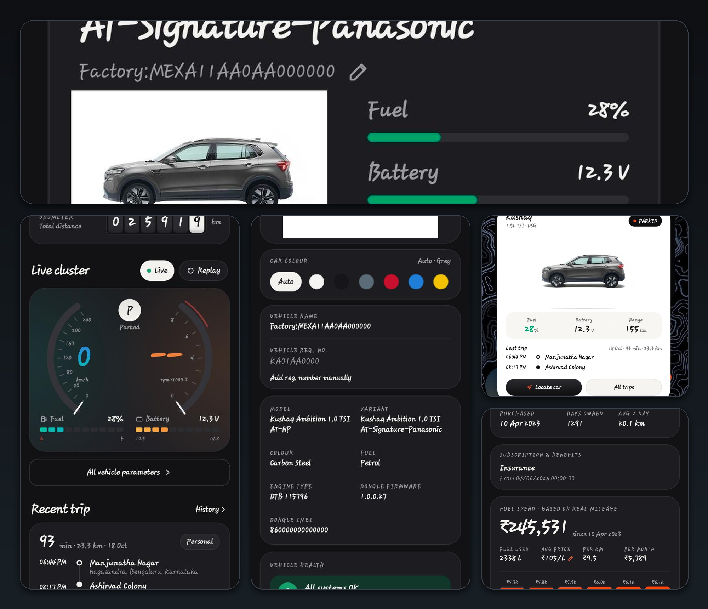
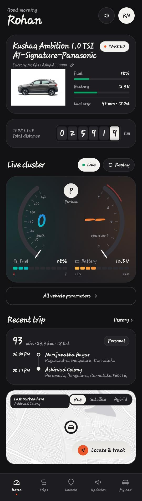
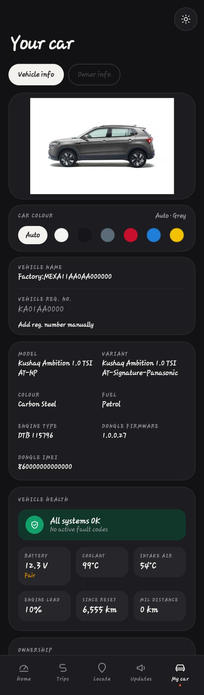
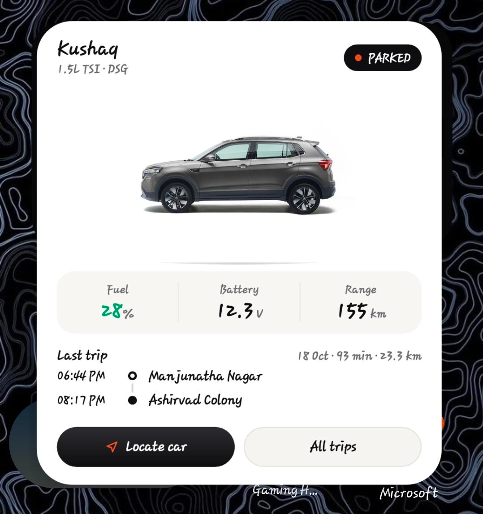
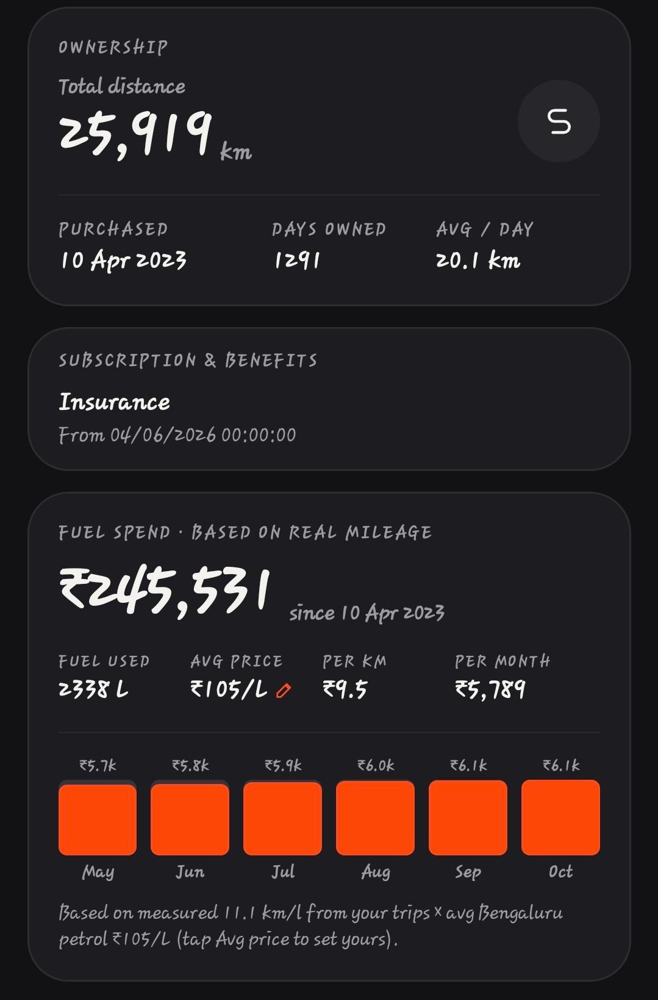

# OpenSkoda

An open, privacy-respecting alternative client for **Skoda Connect / Skoda Plus** (India) — a native Android app that talks to the same telematics stack used by the official app, so you can see your car's live data without ads, tracking, or a cluttered UI.

> Unofficial project. Not made by, affiliated with, or endorsed by Skoda Auto or Volkswagen Group. Use at your own risk. See [Disclaimer](#disclaimer).



## UI Preview



<p align="center">
  
  
  
  
</p>

[](https://github.com/darushah/openskoda/releases/latest) [](https://github.com/darushah/openskoda/releases)

## Download

**[⬇️ Download the latest APK](https://github.com/darushah/openskoda/releases/latest)** — or grab a specific build from [Releases](https://github.com/darushah/openskoda/releases).

- **Download (APK):** https://github.com/darushah/openskoda/releases/latest
- **Source:** https://github.com/darushah/openskoda

Install it, allow "install from unknown sources" when asked, open the app, and sign in with your Skoda Connect mobile number + the OTP you get by SMS. Requires Android 7+.

## Features

**Live data**
- Instrument cluster: speed, RPM, fuel %, battery voltage, coolant and intake-air temperature, engine load, odometer, check-engine (MIL) status and distance since diagnostics reset.
- Real-time **push** updates over the car's telematics hub (SignalR) — values move within seconds while you drive, with no polling. A green **Live** chip shows when connected.
- Animated cockpit "self-test" sweep on the cluster.

**Trips & driving**
- Trip history grouped by day, with start/end places (reverse-geocoded), distance and duration.
- Driving stats: trips, distance, driver score, top speed, idle time, hard stops, and **measured** real-world mileage (km/l) worked out from per-trip fuel use.

**Updates**
- Engine on/off and driving alarms (sudden brake, sharp turn, …) as they happen.
- Alert setup view: geofences and which notification triggers are enabled on your account.

**Locate**
- Open map (OpenStreetMap via osmdroid, Esri tiles — no API key): street, satellite and hybrid.
- Last-parked location taken from the newest telematics event, with **Open in Google Maps**.
- Nearest service workshops, with **Directions** and **Book service** hand-offs to Google Maps.

**My car**
- Vehicle health, ownership summary (total distance, days owned, average per day), and a fuel-spend estimate.
- **Editable petrol price** — set your city's average ₹/L so the cost estimates are right (defaults to Bengaluru).
- **Car colour**: auto-detected from your account, or pick manually from white / black / grey / red / blue / yellow.
- **Model & variant**: automatically detected at OTP login from your connected-car account.
- Owner profile, logout, and a **privacy mode** that masks VIN/registration/personal details for screenshots.

**App**
- **Dark mode** (toggle in the My car header or Owner info).
- Adaptive layout for **foldables and tablets** (navigation rail + two-column home on wide screens).
- **Home-screen widgets** (6): Fuel, Overview, Large, Last trip, Parked location, and a dark lock-screen-style glance. They refresh when you open the app.
- **Android Auto** support: read-only in-car view of vehicle status, fuel/battery, last trip, and parked location.
- Minimal permissions: `INTERNET` and `ACCESS_NETWORK_STATE`. No ads, no analytics, no third-party tracking.

## Will it work with my car?

OpenSkoda works for cars enrolled in **Skoda Connect / Skoda Plus** in **India** — the ones fitted with the plug-in **OBD telematics dongle**. The app uses the same telematics backend family (`…cerenceapi.com`) as the official app.

- **You need:** the mobile number registered on your Connect Plus account (login is by SMS OTP), and the dongle plugged in and reporting for live data.
- **Models:** intended for Skoda India connected-car models (for example **Kushaq, Slavia, Kodiaq, Superb, Octavia**), with automatic variant detection from the account.
- **It won't work** without an active connected-car subscription + dongle, or for unsupported regions/backends.

If you're on an older firmware or a different telematics unit, live values may be partial — please open an issue with what you see.

## Build & run

Requires Android Studio (JDK 17). 

```bash
cd android
./gradlew :app:assembleDebug      # APK in app/build/outputs/apk/debug/
```

Install the APK, open the app, enter your Connect Plus mobile number, and type the OTP you receive by SMS.

`client/` holds a small Node.js reference implementation of the same API (a local bridge + CLI) used while reverse-engineering; the Android app is standalone and does **not** need it.

## How it works / security notes

- All traffic is **HTTPS** to Skoda's and Cerence's own servers. OpenSkoda adds no server of its own — your data goes only to you and to Skoda/Cerence, exactly as with the official app.
- The backend API wraps request/response bodies in **DES** encryption with keys baked into the official app. Those keys are included here because the client can't talk to the API without them; they are obfuscation, not real security — the actual authentication is your per-account **OTP + token**.
- Your session tokens are stored in Android's app-private storage. Like most apps, that's readable on a **rooted/compromised device** — OpenSkoda does not add extra at-rest encryption.
- **Reverse geocoding** (turning parked coordinates into a place name) uses Android's built-in Geocoder, which may send those coordinates to Google. Map tiles come from Esri.
- Do not hammer the login endpoint — the backend rate-limits sign-ins per IP address.

## Contributing

Issues and PRs welcome — especially artwork for other Skoda India models, confirmation of other telematics dongles, and translations.

## Credits

Huge thanks to **[Biswatma](https://github.com/biswatma)** for creating the original **OpenVW** project that inspired and enabled this Skoda-focused fork: https://github.com/biswatma/openvw

## Disclaimer

OpenSkoda is an independent, non-commercial project for interoperability and personal use. "Skoda", "Skoda Auto", "Kushaq", "Slavia", "Kodiaq", and related marks belong to their respective owners. This project is not affiliated with or endorsed by Skoda Auto. It only accesses data for an account you own and control. You are responsible for complying with Skoda's terms of service and your local laws. Provided **as is**, with no warranty.

## License

MIT (see [LICENSE](LICENSE)).
